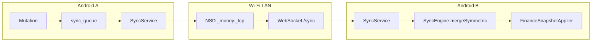
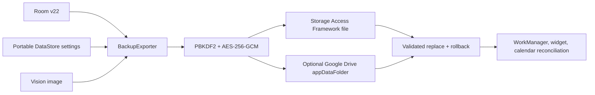

# Project Money — Architecture

Monolithic Local Engine: одна финансовая модель, offline-first, P2P-синхронизация между Android-устройствами в локальной Wi‑Fi сети, web-дашборд как companion UI.

## Принципы

| Принцип | Реализация |
|---------|------------|
| Валюта | Только **USD** |
| Точность | Все суммы — **целые центы** (`number` / `Long`) |
| Источник правды | **Транзакции** (DEPOSIT, GOAL_TRANSFER, EXPENSE) для целей и глобального баланса |
| Offline-first | Room v22 (Android) + localStorage v5 (web) |
| Sync | Schema v3, LWW по `syncUpdatedAt`, отдельные tombstones |
| UI | Milk-Rich M3: фон `#F9F7F2`, positive `#4A7C59`, negative `#B35D5D` |

## Структура репозитория

```
Money/
├── packages/shared/          # Единый TS-контракт (Transaction, FinanceSnapshot, merge)
├── web/                      # React 19 dashboard
├── app/                      # Android (Compose, Room, Glance, TTS, P2P)
├── server/                   # Legacy/dev API (не участвует в P2P sync)
└── ARCHITECTURE.md
```

## Phase A — Data Layer (ядро)

### Web

| Модуль | Назначение |
|--------|------------|
| `@money/shared` | `Transaction`, `FinanceState`, `FinanceSnapshot`, константы |
| `web/src/lib/globalFinanceEngine.ts` | Расчёт баланса из транзакций |
| `web/src/hooks/useFinanceManager.ts` | UI-слой над engine + store |
| `web/src/lib/financeStore.ts` | Persistence `truckerload-finance-v5` |

### Android

| Модуль | Назначение |
|--------|------------|
| `domain/util/GlobalFinanceEngine.kt` | DEPOSIT − GOAL_TRANSFER − EXPENSE |
| `data/local/` | Room v22: business tables, `sync_queue`, `sync_tombstone` |
| `GoalRepositoryImpl` | `currentAmountCents` **derived** из transfers |

### Формулы (обе платформы)

```
globalBalance     = deposits − expenses
availableBalance  = deposits − goalTransfers − expenses
totalAccumulated  = Σ accumulated по активным целям
remainingToGoal   = Σ (target − accumulated) по активным целям
```

## Phase B — Sync Layer (P2P)



| Компонент | Путь |
|-----------|------|
| Контракт snapshot | `domain/sync/FinanceSnapshot.kt` |
| LWW merge | `domain/sync/SyncEngine.kt` |
| Очередь изменений | `data/sync/SyncQueueRecorder.kt` → `sync_queue` |
| NSD discovery | `data/sync/NsdPeerDiscovery.kt` |
| WebSocket server/client | `data/sync/SyncService.kt` (Ktor CIO) |
| Применение snapshot | `data/sync/FinanceSnapshotApplier.kt` |
| TS mirror | `packages/shared/src/syncEngine.ts` |

**Протокол v3:** initiator (больший `deviceId`) шлёт JSON snapshot первым → acceptor отвечает → обе стороны `mergeSymmetric(local, remote)` → apply → `sync_queue.clearAll()`. Snapshot включает debts/payments, unified transactions, voice settings и tombstones.

**Порт:** динамический (`port = 0`), публикуется через NSD. Фиксированный 8080 не используется — меньше конфликтов на устройстве.

**Web P2P:** ручное подключение к URL Android WebSocket peer через
`useWebSync.ts`; browser не публикует NSD service и продолжает хранить данные в
localStorage.

### Маппинг TS ↔ Kotlin (snapshot)

| Shared (TS) | Android (Kotlin) | Примечание |
|-------------|------------------|------------|
| `SnapshotGoal.id: string` | `Long` | Web string; Android Long — **коллизии id** при первом sync двух «пустых» устройств (TODO: UUID) |
| `transactions[]` | `transfers[]` + `expenses[]` | Web unified ledger; Android split tables |
| `syncUpdatedAt: number` | `Long` millis | LWW ключ |
| `deviceId: string` | `String` UUID | `DeviceIdProvider` |

## Phase C — Dashboard UI

### Web (`web/src/pages/Dashboard.tsx`)

- Milk-Rich glass cards, Framer Motion
- `BalanceOverviewCard`, `TransactionHistory`
- Semantic colors из `@money/shared` → `PROJECT_MONEY_THEME`

### Android

- `GlobalBalanceHeader` — остаток, накоплено, до целей
- Phone: single column + tabs
- Tablet (≥600dp): `TabletHomeLayout` — NavigationRail + list + detail pane

## Phase D — Native Features

| Feature | Android |
|---------|---------|
| Glance widget | `widget/GoalProgressWidget.kt` |
| Quick Add FAB | `AppIntents.quickAddIntent()` → `QuickAddDialog` |
| TTS daily report | `VoiceReportWorker` + `STREAM_ALARM` |
| Voice settings | RU/EN, Male/Female, `VoiceSettingsScreen` |
| Network indicator | `SyncStatusIndicator` (green / grey) |

## Backup layer



- `data/backup/` содержит portable bundle v1, codec, password crypto, Room apply/
  rollback, local document gateway, optional Google Drive REST provider и daily
  WorkManager backup.
- Google scope ограничен `drive.appdata`; обычные Drive-файлы недоступны.
- Restore заменяет локальные business tables и portable preferences, очищает
  sync queue/tombstones и возвращает warnings для post-restore reconciliation.
- `DefaultLocalDataResetter` под `SyncWriteGuard` удаляет Room и local state,
  останавливает P2P, сбрасывает device ID, credential, schedules/notifications и
  calendar links. Remote backups остаются, пока пользователь отдельно не выберет
  их удаление.
- Операционные инструкции: `docs/BACKUP_RESTORE.md`.

## Зависимости между слоями

```
@money/shared (types + merge)
       ↓
globalFinanceEngine / GlobalFinanceEngine
       ↓
useFinanceManager / Repositories
       ↓
Dashboard / HomeScreen
       ↓
SyncService (только после мутаций → sync_queue)
```

**Правило:** UI не считает баланс сам — только через engine. Sync не меняет бизнес-правила — только merge + apply snapshot.

## Тесты

```bash
# Node workspaces
npm ci
npm test
npm run build --workspace=money-web

# Android JVM tests/builds
ANDROID_HOME=$HOME/android-sdk ./gradlew :app:testDebugUnitTest :app:assembleDebug
ANDROID_HOME=$HOME/android-sdk ./gradlew :app:bundleRelease
```

Android coverage includes Room migrations, sync v3/tombstones, repositories,
backup encryption/round-trip/rollback, Google Drive transport, automatic backup,
safe local reset, reminders/calendar, ViewModels, finance and psychology logic.
Node coverage includes shared sync/finance engines and web state/UI logic. CI
runs both suites plus Android debug and web production builds.

## Roadmap (следующие шаги)

1. **UUID ids** — убрать коллизии auto-increment при P2P
2. **Web pairing/discovery** — заменить ручной WebSocket URL на безопасное pairing
3. **Unified snapshot** — Android `transactions[]` в JSON или adapter transfers+expenses ↔ transactions
4. **Codegen** — генерация Kotlin data class из `@money/shared` (optional)

## Master Blueprint ↔ статус

| Blueprint phase | Статус |
|-----------------|--------|
| Phase A — Transaction + cents | ✅ |
| Phase B — LocalSyncEngine P2P | ✅ Android |
| Phase C — Milk-Rich dashboard | ✅ |
| Phase D — Widget + TTS | ✅ |
| `packages/shared` | ✅ |
| Web в P2P | ✅ ручной WebSocket URL |

---

*Документ отражает состояние кодовой базы Project Money. Обновляйте при изменении sync-контракта или добавлении web P2P.*
