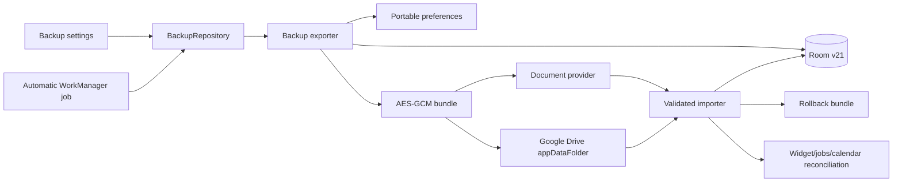

# Local Google Backup and Restore - Plan

## Goal Capsule

Keep Financial Control fully usable offline while adding optional, versioned backup and recovery through the user's Google account. Local Room data remains authoritative. Google authorization must never gate onboarding or normal app use.

## Scope Boundaries

In scope:

- Repair data-loss and UX risks that make backup unsafe.
- Add a complete portable bundle for Room, portable preferences, and the vision image.
- Encrypt backups with a user-supplied backup password and cache the derived key on the originating device for automatic backup.
- Add transactional restore with validation, rollback, and post-restore reconciliation.
- Add local document export/import as a credential-independent recovery path.
- Add Google Drive `appDataFolder` storage through Google Identity Services authorization.
- Add backup settings UI, scheduling, tests, CI, and documentation.

Deferred:

- Real-time multi-device sync through Google Drive.
- A cloud backend, refresh-token service, or server-side conflict resolution.
- Web participation in Android Google backup.
- Product-wide visual redesign.

## Key Technical Decisions

1. `BackupBundle` is independent from P2P `FinanceSnapshot`; backup requires full-fidelity replace semantics while P2P uses LWW merge.
2. Automatic Google backup is best-effort. A background worker silently reacquires authorization when possible and reports `RECONNECT_REQUIRED` when Google requires foreground consent.
3. Backup encryption uses PBKDF2-HMAC-SHA256 plus AES-GCM. The password-derived key is wrapped with Android Keystore for automatic backups; a replacement device requires the password.
4. Restore first validates and decrypts into memory, captures a rollback bundle, then replaces Room data in one transaction. Device-local identifiers are cleared.
5. Widget cache, sync queue, WorkManager state, calendar event IDs, contact URIs, permission flags, and delivery dedup state are not portable.
6. Google Drive access uses only `drive.appdata` and REST v3; no legacy Drive Android API.

## High-Level Technical Design

## Verification Contract

- Existing Android JVM tests remain green.
- Bundle codec round-trips every portable field and rejects corruption, wrong passwords, incompatible schema versions, and oversized payloads.
- Room export/import tests preserve all business records and foreign-key relationships.
- Import failure restores the exact pre-import state.
- Google storage tests use a fake HTTP transport; no credentials are required in CI.
- UI state tests cover disconnected, connected, backing up, restore preview, success, reconnect-required, and failure.
- Full Android debug build and Node/web tests pass.

## Implementation Units

### U1. P0 safety and UX fixes

**Goal:** Remove immediate data-loss and navigation risks.

**Files:** `app/src/main/java/com/example/money/ui/home/HomeScreen.kt`, `app/src/main/java/com/example/money/ui/debtors/DebtorsViewModel.kt`, related UI tests.

**Approach:** Keep top-level tabs reachable, confirm mark-paid, expose persistence failures, and keep local sync controls out of ordinary menus.

**Verification:** Critical phone navigation and destructive-action tests pass.

### U2. Portable backup contract and crypto

**Goal:** Define and validate a complete encrypted backup format.

**Files:** new `app/src/main/java/com/example/money/domain/backup/`, `app/src/main/java/com/example/money/data/backup/`, unit tests.

**Approach:** JSON/ZIP bundle with manifest, room records keyed by sync IDs, portable preferences, optional vision image, checksum, PBKDF2, and AES-GCM.

**Verification:** Deterministic round-trip and negative crypto/validation scenarios pass.

### U3. Room and preferences export/import

**Goal:** Capture and restore all portable user data with rollback.

**Files:** DAOs, `MoneyPreferencesStore`, `AppLanguageStorage`, new exporter/importer/applier tests.

**Approach:** Read consistently under the sync write mutex; apply in FK-safe order using sync-ID remapping; exclude transient/device-local state.

**Verification:** In-memory Room integration tests prove exact business-state restoration and rollback.

### U4. Restore reconciliation

**Goal:** Make restored data operational on the new device.

**Files:** `MoneyApplication.kt`, new `PostRestoreReconciler`, widget/scheduler/calendar integration points.

**Approach:** Cancel stale jobs and notifications, regenerate derived widget state, reschedule enabled jobs, clear calendar handles, and recreate calendar events only when authorized.

**Verification:** Reconciler tests verify every subsystem is invoked once after success and never after failed import.

### U5. Storage providers and Google authorization

**Goal:** Support local files and Google Drive app-data storage.

**Files:** new provider interfaces/implementations, Gradle dependencies, manifest configuration, provider tests.

**Approach:** Local SAF is always available. Google uses foreground `AuthorizationClient` resolution and REST requests; worker retries silently or marks reconnect required.

**Verification:** Fake Drive transport covers list/upload/download/delete, HTTP errors, pagination, and authorization-resolution states.

### U6. Backup settings UI

**Goal:** Give users clear backup, restore, status, and account controls.

**Files:** new settings screen/view model/state, `AppRoutes.kt`, `MoneyNavHost.kt`, phone/tablet settings entries, RU/EN strings.

**Approach:** Optional Google connection, manual backup, automatic backup constraints, restore preview, password prompts, local export/import, delete cloud backups, and explicit disconnect.

**Verification:** ViewModel state tests and manual phone/tablet walkthrough.

### U7. Scheduling, release, CI, and documentation

**Goal:** Make the feature maintainable and releasable.

**Files:** WorkManager worker/scheduler, `.github/workflows/`, `ARCHITECTURE.md`, `docs/BACKUP_RESTORE.md`, privacy documentation, build metadata.

**Approach:** Unique daily best-effort backup, visible last-success/reconnect state, no token persistence, CI gates, and Google Cloud/Play setup checklist.

**Verification:** Worker tests, complete Android/Node test suites, debug APK, and release configuration checks.

## Definition of Done

- App remains fully usable without Google or network.
- Local encrypted export/import works without external credentials.
- Google authorization and app-data storage code compiles and is testable without secrets.
- Automatic backup reports last success and reconnect requirements.
- Restore is transactional, rollback-safe, and restores all portable data.
- Widget, reminders, autopilot, weekly check-in, voice scheduling, and calendar state are reconciled.
- Critical P0 UI/data risks are fixed.
- CI and setup documentation describe the remaining Google Cloud Console values required for production.
